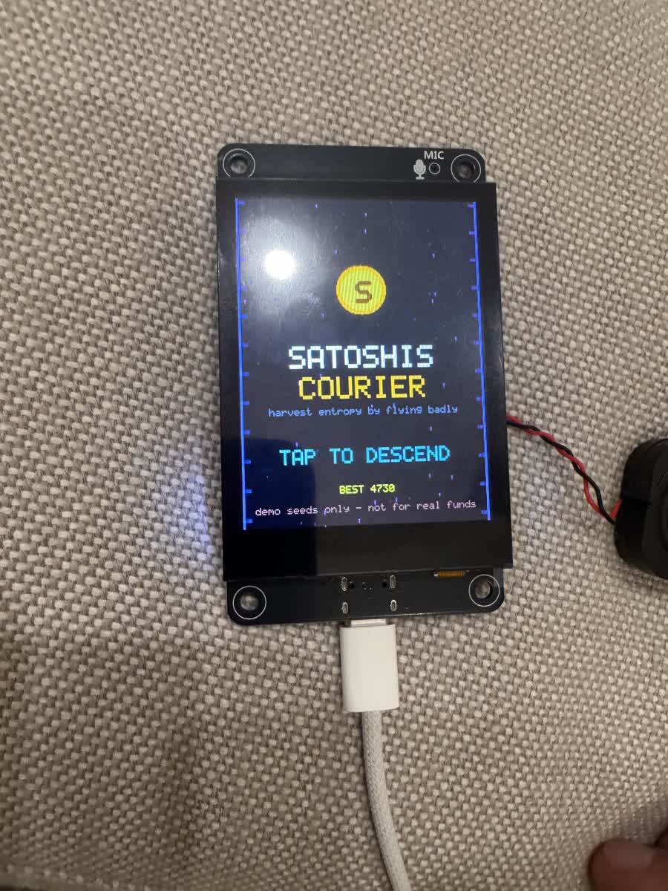
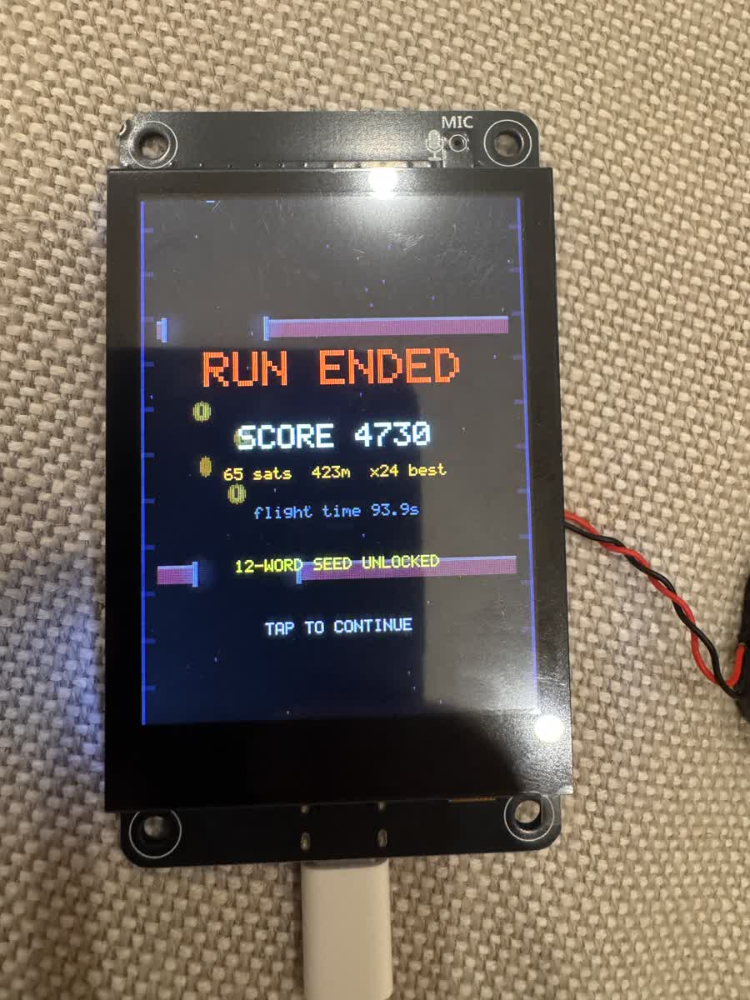
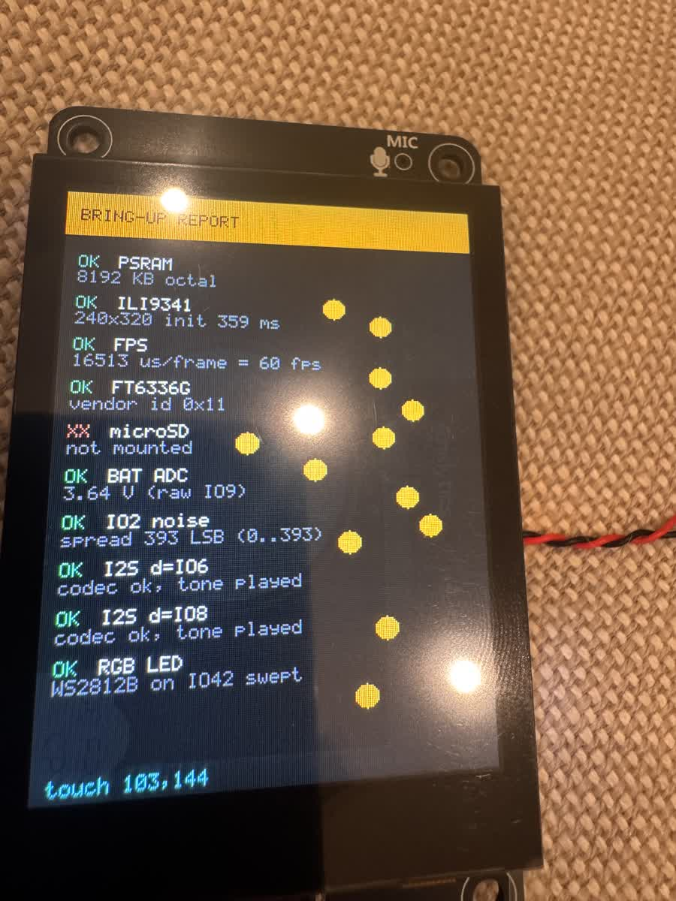

# Satoshi's Courier

A Bitcoin-themed arcade game for the **ES3C28P** (ESP32-S3 + 2.8" ILI9341 + capacitive
touch). You fall down a neon shaft collecting sats and threading gaps. Your flying —
every drag, every hesitation, every crash — is folded into an entropy pool. Survive long
enough and the game hands you a BIP-39 mnemonic.

**The joke:** flying *badly* pays. More time in the air and more frantic input means more
entropy. A flawless speedrun produces nothing at all.

> **DEMO ONLY.** Entropy is harvested from game play. Not suitable for real Bitcoin
> storage. Verify independently before any use. Do not fund these seeds.

<p align="center">
  
  
  
</p>

Running on a stock **ES3C28P** board. 58.9 fps, all audio synthesised on-chip, no
external assets.

---

## Controls

| Input | Action |
|---|---|
| **Drag anywhere** | Steer the ship left/right. The ship sits high so your hand never covers it. |
| **Tap** | Start a run / advance menus |
| **BOOT button** | Volume, on every screen: `HIGH → MED → LOW → MUTE → HIGH` |
| **Speaker widget** (title, top-left) | Same volume cycle, if the button isn't handy |

Volume cycles *downward* on purpose — when you need the noise gone, the first press
should already help. At `MUTE` the FM8002E amplifier is switched off entirely, which
also kills idle hiss. The level is stored in NVS and survives reboots and reflashes; the
boot screen prints it before any sound plays.

---

## Build & flash

```bash
export PATH="$HOME/.platformio/penv/bin:$PATH"
pio run -t upload          # builds and flashes over /dev/ttyACM0
pio device monitor         # serial log
```

Toolchain: PlatformIO 6.2.0 + pioarduino `espressif32` + **ESP-IDF 5.5.5**, board
`esp32-s3-devkitc1-n16r8`. The board enumerates as native USB-JTAG, so no reset
button dance is needed.

## Hardware

See **[BOARD.md](BOARD.md)** for the full verified pin map and the gotchas found during
bring-up. Everything there was confirmed on the physical board, including the I2S
DOUT/DIN pinout, which the two public sources disagree about (the firmware resolves it
by mic loopback — the vendor table is right, the community BSP is wrong).

| | |
|---|---|
| MCU | ESP32-S3-N16R8 — 16 MB flash, 8 MB octal PSRAM |
| Display | ILI9341V 240×320 IPS, 4-wire SPI @ 80 MHz |
| Touch | FT6336G capacitive, raw coords map 1:1 to screen |
| Audio | ES8311 codec + FM8002E amp (amp enable is **active low**) |
| Storage | microSD, SDIO 4-bit |
| Extras | WS2812B RGB LED, MEMS mic, battery ADC |

## Performance

Measured on device, not estimated:

| State | FPS | Logic time | Budget used |
|---|---|---|---|
| Title | 58.8 | 7.6 ms | 45% |
| Gameplay at max speed | 58.9 | 10.2 ms | 60% |

The panel is the bottleneck: 240×320×16bpp over 80 MHz SPI is 15.4 ms of pure
bandwidth. The framebuffer is **double-buffered in PSRAM** with an async DMA flush, so
each frame's logic runs *during* the previous frame's transfer. Serialised, the same
workload would run at roughly 26 fps.

Two build flags in `platformio.ini`, both off by default:

| Flag | Effect |
|---|---|
| `-DSTRESS_AUTOPLAY=1` | Skips the title and flies the ship with a synthetic sweep, for profiling the heaviest render state without a human at the panel. |
| `-DSEED_WRITE_TEST=1` | At boot, writes a seed file from a known BIP-39 vector, reads it back, verifies the round trip and deletes it. Exercises the real write path without a 90-second flight. |

## Audio

Every sound is **synthesised at boot into PSRAM** (~356 KB), so the firmware ships no
audio assets. A mixer task pinned to core 1 sums up to 8 one-shot voices against a live
chiptune sequencer (square bass, detuned twin-square lead, noise percussion in A minor),
soft-clipping the result. Music intensity rises with descent speed.

## Entropy & seed generation

`esp_random()` is only a true RNG while a physical entropy source runs, and Espressif
requires that source be **disabled before any ADC use** — which this project needs for
the battery and the floating-pin taps. So the firmware follows the documented pattern:

1. Enable the hardware entropy source at boot, harvest 48 bytes, disable it.
2. Seed an mbedTLS **CTR-DRBG** from that, personalised with the device MAC.
3. During play, hash gameplay into a pool: action timestamps and deltas, touch
   coordinates, MEMS mic samples, and floating ADC taps on the expansion header
   (measured at ~380 LSB of real jitter per 64 reads).
4. At the end of a run, reseed the DRBG with that pool and draw the entropy.

So the **cryptographic floor is the hardware TRNG plus a vetted DRBG**, and the gameplay
entropy is genuinely mixed in on top. The on-screen bit counter is the game mechanic —
it is not the security basis, and the code says so.

BIP-39 conversion is checked against the **official test vectors at every boot** (7
vectors covering 12- and 24-word cases); the boot screen reports `VECTORS OK` or
disables seed generation.

### Gates (`include/config.h`)

| | Flight time | Actions |
|---|---|---|
| 12 words (128-bit) | ≥ 90 s | ≥ 60 |
| 24 words (256-bit) | ≥ 180 s | ≥ 150 |

Below the lower gate you get a score and nothing else.

### SD save

Writing is opt-in and guarded: a full-screen plaintext warning, then a **2-second
deliberate hold** with a progress fill before anything touches the card. Files land at
`/sdcard/seedNNNN.txt` with a warning header, the phrase, numbered words, and the run
stats. The mnemonic is wiped from RAM when the screen closes.

A successful mount says nothing about whether writes work, so the firmware runs a real
create/write/close/delete **probe at boot** and shows `rw` or `RO!` on the splash screen.
Write failures report the actual `errno`, not a guess. (See BOARD.md for why: IDF's
default 8.3-only filenames silently broke `fopen` for names over 8 characters.)

## Layout

```
platformio.ini        sdkconfig.defaults     partitions.csv
include/              board.h config.h display.h touch.h audio.h sfx.h
                      entropy.h bip39.h bip39_words.h storage.h rgbled.h
                      game.h seedui.h
src/                  main.c      boot + self-test, hands off to the game
                      game.c      descent, collision, render, state machine
                      display.c   ILI9341 driver, double buffer, blending
                      sfx.c       synthesis + mixer + chiptune sequencer
                      entropy.c   TRNG floor, DRBG, gameplay pool
                      bip39.c     mnemonic + official test vectors
                      seedui.c    seed display, guarded SD write
                      touch.c audio.c storage.c rgbled.c board.c
components/es8311/    vendored Espressif driver (Apache-2.0), I2C API ported
tools/                bring-up firmware kept for reference
```

## Credits

ES8311 codec driver vendored from [espressif/esp-bsp](https://github.com/espressif/esp-bsp)
(Apache-2.0); see `components/es8311/VENDORED.md` for the local modification.
Wordlist from [bitcoin/bips](https://github.com/bitcoin/bips) BIP-39 English
(`sha256 2f5eed53…b24dbda`).
